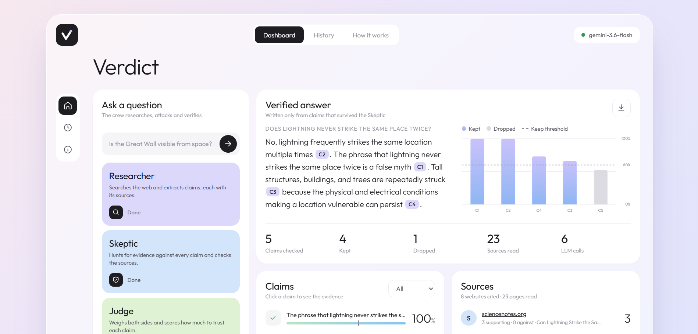
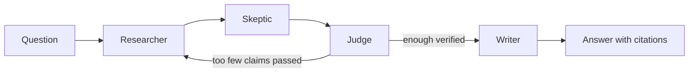
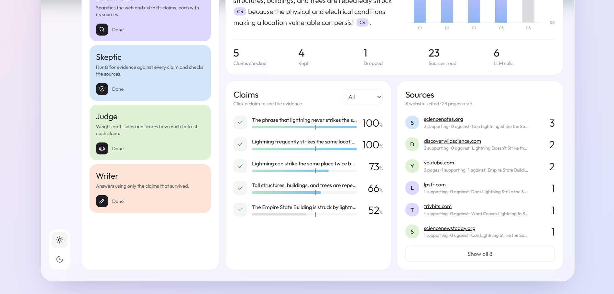
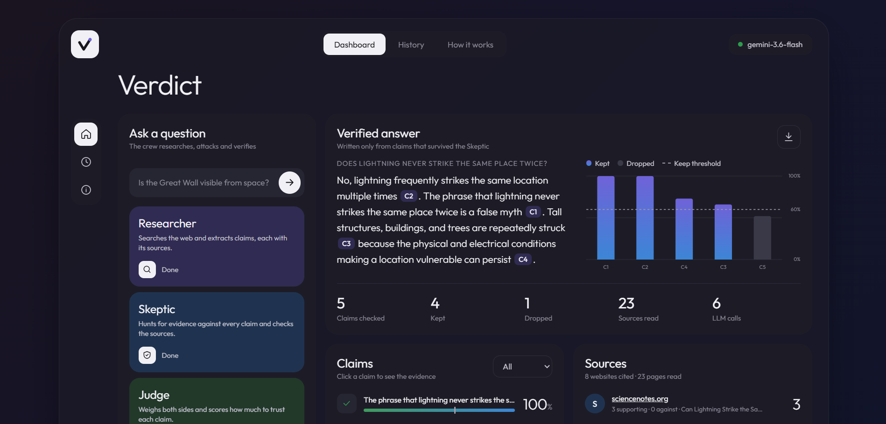

# Verdict

Ask a chatbot "do we only use 10% of our brain?" and you'll get a confident, well-written answer. Whether it's actually true is a different story. Language models are trained to sound right, not to be right, and from the outside you can't tell the difference.

I wanted to build something that doesn't take its own word for it. Verdict is a small team of AI agents that researches a question, then tries hard to prove itself wrong, and only answers with the claims that survive.



## How it works

The idea is borrowed from how a newsroom works: one person writes, another person fact-checks, an editor decides what gets printed.



1. **Researcher** searches the web and breaks what it finds into small, checkable claims. Each claim has to point to the pages it came from.
2. **Skeptic** runs its own searches looking for evidence *against* every claim. It also checks whether the claim really matches its source, and whether the source is any good.
3. **Judge** looks at both sides and gives each claim a verdict (supported, contested, refuted or unverifiable) plus a confidence score.
4. **Writer** answers the question using only the claims that passed. It never sees the raw web pages, so it can't sneak in anything unchecked.

If too few claims pass, the Researcher goes back for another round. If nothing holds up, Verdict says it doesn't have enough evidence instead of making something up.

### Why I don't trust the Judge's confidence on its own

LLMs are usually overconfident about their own judgments, so the final score mixes the Judge's opinion with things I can count in code:

```
final = 0.6 × judge confidence + 0.4 × number of independent websites − skeptic penalty
```

Three different websites saying the same thing count for more than one blog. Two pages from the same site count once. A strong objection from the Skeptic costs 0.4. Anything below 0.6 gets dropped, and it's still shown in the report, so you can see what was thrown out and why.

## A few things that happened while building it

**The Skeptic was useless at first.** In the first runs it found counter-evidence for only 1 of 4 claims. It turned out it was writing long, very specific search queries that matched nothing. Asking for two short queries per claim, one "is this false?" and one "is this missing context?", plus retrying empty searches with fewer words, got it to 4 out of 4.

**It caught a dropped caveat.** Asked whether sugar makes kids hyperactive, the Researcher wrote "a 1995 meta-analysis concluded sugar does not affect behaviour". The Skeptic pointed out that the study's authors said they *couldn't rule out a small effect*. The claim had quietly lost its qualifier, which is exactly how a lot of misinformation spreads. It got dropped.

**Free APIs fail a lot.** I use Gemini's free tier, and it regularly answers with "503, high demand" or "429, out of quota". The LLM layer now retries with increasing waits, falls back to a second model, and remembers for 10 minutes when a model is down (a circuit breaker), so the crew doesn't waste a minute retrying a dead model on every call.

**Small guards matter.** The model sometimes cites sources that don't exist, skips a claim, or cites a claim that was rejected. Each of these is checked in plain Python after every LLM call, not left to the prompt.

## Screenshots

| Claims and sources | Dark mode |
|---|---|
|  |  |

You can click any claim to see the Judge's reasoning, the Skeptic's objection and the sources on both sides. There's also a full [example report](docs/example-report.md).

## Tech

- **Python** with **LangGraph** to run the agents as a graph (it handles the research loop)
- **Google Gemini** (free tier) with structured outputs, so every agent answers in a fixed JSON shape checked by **Pydantic**
- **DuckDuckGo search** through `ddgs`, so no search API key is needed
- **FastAPI** backend that streams each agent's progress to the browser with Server-Sent Events
- A plain **HTML, CSS and JavaScript** frontend, no framework; the chart is hand-drawn SVG
- **pytest** with a fake LLM, so the whole pipeline can be tested offline and for free

## Running it

You'll need Python 3.10+ and a free Gemini API key from [Google AI Studio](https://aistudio.google.com/apikey).

```bash
git clone <your-repo-url>
cd verdict
python -m venv .venv
.venv\Scripts\activate          # on Mac/Linux: source .venv/bin/activate
pip install -r requirements.txt
copy .env.example .env          # on Mac/Linux: cp .env.example .env
```

Put your key in `.env`, then start the dashboard:

```bash
python -m uvicorn server:app --port 8000
```

and open http://localhost:8000. You can also use it from the terminal:

```bash
python main.py "Does cracking your knuckles cause arthritis?"
```

Each question takes about 6 to 10 LLM calls, so on the free tier it's worth waiting a minute between questions.

## Tests

```bash
pip install -r requirements-dev.txt
pytest
```

The tests swap the LLM and web search for fakes, so they run in under a second without a key. They cover the confidence formula, the citation guards, the research loop, unsafe links, and the API (including a check that nobody can read files like `.env` through the URL).

## Project layout

```
crew/
  agents.py    the four agents and the confidence formula
  graph.py     wires them together with LangGraph
  llm.py       the only file that talks to Gemini (retries, fallback, circuit breaker)
  search.py    the only file that talks to the web
  schemas.py   the shape of every piece of data
  report.py    Markdown and JSON reports
server.py      FastAPI backend
web/           dashboard (HTML, CSS, JS)
main.py        command-line version
tests/         pytest suite
LESSONS.md     long-form notes explaining every concept and every line of code
```

## Limitations

- It's only as good as what the search engine returns. Popular topics work well; niche or very recent topics often don't have enough sources.
- The confidence formula is hand-tuned. The weights feel reasonable, but I haven't measured how well calibrated they are yet.
- The Skeptic and the Judge are the same model as the Researcher, just with different instructions. They catch a lot, but they share some blind spots.

## What's next

- An evaluation set of questions with known answers, so I can actually measure accuracy instead of eyeballing it
- Giving more weight to reliable sources (government, universities, journals) than to random blogs
- Running the Skeptic's checks in parallel to make it faster
